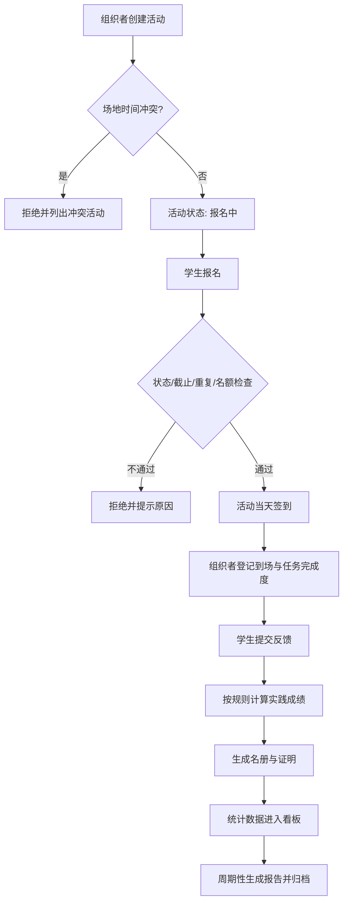

# 需求文档

## 1. 业务场景与角色

高校每学期举办大量讲座、竞赛、志愿服务和文体活动。传统“群接龙 + 表格 + 纸质签到”方式存在名额超员、场地冲突、签到手录、成绩人工计算、统计口径不一致等问题。本平台覆盖活动从发布到归档的全过程，并在适合环节引入大模型能力。

### 三类角色

| 角色 | 主要诉求 | 可执行操作 |
|---|---|---|
| 学生 | 找活动报名、查成绩、取得证明 | 浏览活动、报名与取消、提交反馈、查看本人成绩、提问 |
| 活动组织者 | 发布活动控人数、少做重复劳动、了解效果 | 维护本人活动、登记到场与任务、导入数据、生成名册证明、看统计 |
| 管理员 | 掌握全校活动、保证数据准确、留存材料 | 管理全部活动与场地、全局看板、运行工作流、查看日志 |

> 平台不做真实账号密码登录，用侧边栏“当前用户”下拉框模拟；但权限控制真实实现：学生看不到他人成绩，组织者不能改他人活动。

## 2. 业务流程图

## 3. 活动状态转换规则

| 状态 | 含义 | 允许转换到 | 触发角色 |
|---|---|---|---|
| draft 草稿 | 已创建未发布 | open / cancelled | 组织者、管理员 |
| open 报名中 | 开放报名 | closed / cancelled | 组织者、管理员 |
| closed 报名截止 | 报名结束待举办 | finished / cancelled | 组织者、管理员 |
| finished 已结束 | 活动完成 | （终态） | — |
| cancelled 已取消 | 活动取消 | （终态） | 组织者、管理员 |

不提供物理删除，只改状态，以免已有报名记录失去归属。被取消的报名不占名额，被取消的活动不占场地。

## 4. 核心业务规则

### R1 报名检查（依次执行）
1. 活动状态为“报名中”，且当前时间不晚于报名截止时间；
2. 同一学生对同一活动不存在有效报名（取消后允许再次报名）；
3. 有效报名数未达到活动名额。

检查与写入须在同一事务内，并用数据库唯一索引兜底重复报名。

### R2 场地时间冲突
同一场地存在未取消的活动，且两时间段满足“甲开始 < 乙结束 且 乙开始 < 甲结束”即冲突；首尾相接不算冲突；修改活动自身时排除自己。

### R3 实践成绩计算（课程统一规定，不得更改）
- 出勤分：准时 40、迟到 30、缺席记 0；
- 任务分：任务完成度（0—100） × 0.5；
- 反馈分：活动结束后 3 天内（含第 3 天同一时刻）提交得 10；
- 缺席直接记 0，不计任务分和反馈分；
- 三项相加后四舍五入取整（用 Decimal，不得用内置 round）；
- 未登记到场，或已到场但任务未评定 → 成绩为空（显示“未评定”），不得显示 0；
- 等级：≥90 优秀，80—89 良好，60—79 合格，<60 不合格。

### R4 数据清洗（8 类问题）
见 `docs/数据清洗规则.md`。原则：可自动修复的修复并记录；关键字段缺失、非法值、重复矛盾、引用不存在的不入库并列异常清单；非关键字段缺失入库但按“未评定”处理；任何一行要么入库、要么在异常清单中有“未入库”记录，不允许无声丢弃。

### R5 统计口径
见 `docs/统计口径.md`。

## 5. 用户故事清单（≥12 条，三类角色覆盖，含 ≥2 条智能功能）

> 三类角色均已覆盖，含 4 条智能功能故事。每条故事均附“假设—当—那么”形式的验收条件（见下方逐条展开），可直接照着测试。

| 编号 | 用户故事 | 单元 | 优先级 |
|---|---|---|---|
| US-01 | 作为组织者，我想要创建新活动并自动检查场地冲突，以便避免撞车 | U2 | 必须 |
| US-02 | 作为组织者，我想要修改和取消自己发布的活动，以便调整安排 | U2 | 必须 |
| US-03 | 作为学生，我想要报名参加一场活动，以便获得参与资格 | U2 | 必须 |
| US-04 | 作为学生，我想要在活动开始前取消报名，以便释放名额 | U2 | 应该 |
| US-05 | 作为组织者，我想要登记学生的到场与任务完成度，以便计算成绩 | U2 | 必须 |
| US-06 | 作为学生，我想要查看本人的实践成绩和等级，以便了解进展 | U2 | 必须 |
| US-07 | 作为组织者，我想要导入历史报名与成绩文件并查看异常清单，以便清洗数据 | U3 | 必须 |
| US-08 | 作为组织者，我想要按模板批量生成实践证明与活动名册，以便减少重复劳动 | U3 | 必须 |
| US-09 | 作为管理员，我想要查看活动统计看板并切换筛选，以便掌握全校情况 | U4 | 必须 |
| US-10 | 作为管理员，我想要导出筛选结果为 CSV/Excel，以便存档 | U4 | 应该 |
| US-11 | 作为组织者，我想要预测新活动的到场人数，以便准备场地物资 | U5 | 应该 |
| US-12 | 作为管理员，我想要了解学生参与分群结构，以便改进活动组织 | U5 | 可以 |
| US-13 | 作为组织者，我想要查看学生反馈的主题分布与摘要，以便改进活动 | U6 | 必须 |
| US-14 | **作为学生，我想要就实践学分政策提问并看到依据来源，以便核对该怎么做** | U6 | 必须（智能） |
| US-15 | **作为组织者，我想要上传签到表图片自动识别并人工修正，以便快速登记到场** | U7 | 必须（智能） |
| US-16 | 作为组织者，我想要转写筹备会议录音并提取待办，以便减少记录工作 | U7 | 应该（智能） |
| US-17 | 作为管理员，我想要一键生成活动周报并归档，以便周期性汇报 | U8 | 必须 |
| US-18 | 作为任意角色，我想要用自然语言向助手查询活动信息，以便快速获取结果 | U8 | 应该（智能） |
| US-19 | 作为管理员，我想要查看工具调用日志并按条件筛选，以便追查助手行为 | U8 | 应该 |

### 用户故事验收条件（逐条，共 19 条）

**US-01 创建活动并自动检查场地冲突**（组织者 / U2）
1. 假设博学报告厅 2026-12-05 14:00—16:00 已有活动，当创建同场地 15:00—17:00 的活动，那么保存被拒并列出冲突活动标题；
2. 假设同上，当创建同场地 16:00—18:00 的活动，那么保存成功（首尾相接不算冲突）；
3. 假设同场地已有活动的状态为 cancelled，当创建同场地同时段活动，那么保存成功（已取消不占场地）。

**US-02 修改与取消自己发布的活动**（组织者 / U2）
1. 假设活动状态为 draft 或 open，当组织者修改名额或时间，那么保存成功；
2. 假设活动状态为 finished，当组织者尝试取消，那么操作被拒并提示终态不可改；
3. 假设组织者 A 尝试修改组织者 B 的活动，那么被拒并提示无权操作；
4. 假设活动取消前有名额和场地占用，当取消成功，那么名额与场地时段释放，原报名记录保留且状态变为 cancelled。

**US-03 报名活动**（学生 / U2）
1. 假设活动报名中且名额未满，当学生点击报名，那么报名成功并在“我的活动”可见；
2. 假设已报名该活动，当再次报名，那么提示“请勿重复报名”，名额不变；
3. 假设名额 30 且已有 30 人有效报名，当第 31 人报名，那么提示“报名人数已满”；
4. 假设当前时间晚于报名截止时间，当报名，那么提示已截止；
5. 假设活动状态为 closed，当报名，那么提示“活动当前不在报名阶段”。

**US-04 取消报名**（学生 / U2）
1. 假设学生已报名且活动未开始，当取消报名，那么报名状态变为 cancelled，名额释放；
2. 假设报名已取消，当再次报名同一活动且名额未满，那么报名成功（取消后允许再报名）；
3. 假设学生未报名该活动，当取消，那么提示无有效报名记录。

**US-05 登记到场与任务完成度**（组织者 / U2）
1. 假设学生到场且任务完成度为 85，当组织者登记，那么保存成功并可参与成绩计算；
2. 假设到场情况填“来了”，当提交，那么被拒并提示取值只能是 present / late / absent；
3. 假设任务完成度填 105，当提交，那么被拒并提示必须在 0—100 之间；
4. 假设学生缺席，当保存，那么实践成绩直接记 0，不计任务分和反馈分。

**US-06 查看本人成绩与等级**（学生 / U2）
1. 假设出勤准时、任务完成度 85、活动结束后第 2 天提交反馈，当查看成绩，那么显示 40+42.5+10=93 分、等级“优秀”；
2. 假设出勤准时、任务完成度 85、未提交反馈，当查看成绩，那么显示 40+42.5=83 分（不是 82）、等级“良好”；
3. 假设任务完成度未评定，当查看成绩，那么显示“未评定”，不显示 0；
4. 假设学生 A 查看学生 B 的成绩，那么被拒（学生只能看本人成绩）。

**US-07 导入数据并查看异常清单**（组织者 / U3）
1. 假设 scores_import.csv 共 70 行，其中 8 行存在问题，当导入，那么读取行数 70 = 入库 62 + 未入库异常 8；
2. 假设某行学号为“ 20240011 ”（前后空格），当导入，那么去掉空格后入库，异常清单记“格式不规范 / 已修复”；
3. 假设某行任务完成度为“优”，当导入，那么该行不入库，清单记“非法值 / 未入库”；
4. 假设同一学生同一活动两行任务分分别为 88 和 99，当导入，那么两行都不入库，清单记“重复且矛盾 / 待人工确认”；
5. 假设某行为 GBK 编码的 CSV，当导入，那么按 GBK 正确解码入库，不出现乱码。

**US-08 批量生成名册与证明**（组织者 / U3）
1. 假设某活动有名册数据，当点击“生成名册”，那么产出 docx 文件且表格行数等于有效报名人数；
2. 假设 3 名学生成绩分别为 90、75、59，当批量生成证明，那么只为前 2 人生成（成绩 ≥60），第 3 人不生成；
3. 假设模板中的 {{姓名}} 等占位符未被替换，那么该文件判定为生成失败，不交付。

**US-09 查看统计看板并切换筛选**（管理员 / U4）
1. 假设活动 A 名额 100、有效报名 80、到场 60，当查看看板，那么报名率 80%、到场率 75%；
2. 假设先筛选“讲座”类再筛选“计算机学院”，那么三项比率的分子与分母都只统计该学院参与讲座的学生；
3. 假设活动 B 有效报名 0 人，当查看到场率，那么显示“—”，不显示 0 或报错；
4. 假设汇总报名率由 2 场活动（名额 100 报 60、名额 50 报 30）构成，那么显示 90/150=60%，不是 (60%+60%)/2。

**US-10 导出筛选结果**（管理员 / U4）
1. 假设看板当前筛选后有 5 场活动，当导出 CSV，那么文件含 5 行且中文用 UTF-8 BOM，Excel 打开不乱码；
2. 当导出 Excel，那么文件数值与页面显示一致（比率保留相同小数位）。

**US-11 预测新活动到场人数**（组织者 / U5）
1. 假设历史数据按开始时间排序共 120 场，当评估，那么前 96 场训练、后 24 场检验，不随机打乱；
2. 当查看结果，那么同时显示基线 MAE 与回归 MAE，并据较小者标注胜出方法；
3. 当预测一场新活动，那么预测人数标注为“估计”，并给出可通俗理解的系数解释。

**US-12 查看学生参与分群**（管理员 / U5）
1. 假设某学生报名次数为 1，当聚类，那么该学生单列“参与较少”，不进入簇；
2. 当查看结果，那么只展示各簇人数与特征均值，不展示任何个人的分群标签；
3. 假设轮廓系数可计算，当查看，那么显示数值并说明簇数选择理由。

**US-13 查看反馈主题分布与摘要**（组织者 / U6）
1. 假设活动有 10 条反馈，当分类，那么每条被赋予一个预设主题标签；
2. 假设反馈不足 5 条，当请求摘要，那么提示“反馈过少，请查看原文”，不生成摘要；
3. 假设模型输出不是合法 JSON，当解析，那么该条记为失败并保留原文，不写入脏数据。

**US-14 就实践学分政策提问并看到依据**（学生 / U6 / 智能）
1. 假设知识库含《实践学分认定办法》，当提问“实践学分认定的条件是什么”，那么回答引用“成绩 60 分及以上”等原文依据；
2. 当回答展示，那么列出来源文件名与章节，且可展开查看原文片段及相似度；
3. 假设提问“食堂几点关门”而资料未覆盖，那么回答“资料中未覆盖该问题”，不编造答案。

**US-15 上传签到表图片自动识别并人工修正**（组织者 / U7 / 智能）
1. 假设上传一张签到表图片，当识别，那么展示识别结果与原始图片供对照；
2. 假设识别的学号有误，当人工修正后确认，那么系统记录修正前值、修正后值、操作人和时间；
3. 假设存在未修正的问题行，当点击“确认写入”，那么整个写入被拒并列出问题行，不允许部分带错入库；
4. 假设签到表底部有预留空白行（只有序号、无学号与姓名），当识别与核对，那么空白行被剔除，不进入核对表、不写入到场情况，且页面提示已剔除行数。

**US-16 转写会议录音并提取待办**（组织者 / U7 / 智能）
1. 假设上传一段 5 分钟 WAV，当转写，那么按不超过 120 秒切分为 3 段并逐段转写；
2. 假设其中 1 段转写失败，当重试，那么只重试该段，已成功段落不重复调用；
3. 当提取待办，那么每条待办含任务、负责人、截止时间和原文引用，转写稿可人工编辑后再摘要。

**US-17 一键生成活动周报并归档**（管理员 / U8）
1. 假设统计、摘要、报告、归档四步均成功，当运行工作流，那么生成周报文档并记录一条成功运行日志；
2. 假设模型摘要步骤失败，当运行工作流，那么用统计数字降级生成报告，并在结果中标注“已降级”，不中断后续归档；
3. 假设某步骤失败，当查看结果，那么明确显示失败步骤与原因，便于重跑。

**US-18 用自然语言查询活动信息**（任意角色 / U8 / 智能）
1. 假设提问“有哪些报名中的活动”，当助手调用查询工具，那么返回报名中活动列表；
2. 假设助手请求执行写操作，那么工具被拒、不修改数据，并在日志中记 ok=0；
3. 当一次查询返回超过工具上限的记录，那么按上限截断并提示总数，避免一次性拉取过多数据。

**US-19 查看工具调用日志**（管理员 / U8）
1. 假设助手调用工具 5 次（3 成功、2 被拒），当查看日志，那么显示 5 条，含用户名、角色、工具、参数、ok 标记与耗时；
2. 当按“被拒绝/失败”筛选，那么只显示 ok=0 的 2 条；
3. 当导出日志 CSV，那么导出内容与当前筛选结果一致。
