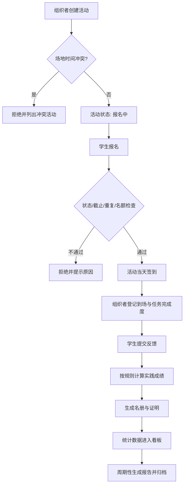

# 需求文档

## 1. 业务场景与角色

高校每学期举办大量讲座、竞赛、志愿服务和文体活动。传统“群接龙 + 表格 + 纸质签到”方式存在名额超员、场地冲突、签到手录、成绩人工计算、统计口径不一致等问题。本平台覆盖活动从发布到归档的全过程，并在适合环节引入大模型能力。

### 三类角色

| 角色 | 主要诉求 | 可执行操作 |
|---|---|---|
| 学生 | 找活动报名、查成绩、取得证明 | 浏览活动、报名与取消、提交反馈、查看本人成绩、提问 |
| 活动组织者 | 发布活动控人数、少做重复劳动、了解效果 | 维护本人活动、登记到场与任务、导入数据、生成名册证明、看统计 |
| 管理员 | 掌握全校活动、保证数据准确、留存材料 | 管理全部活动与场地、全局看板、运行工作流、查看日志 |

> 平台不做真实账号密码登录，用侧边栏“当前用户”下拉框模拟；但权限控制真实实现：学生看不到他人成绩，组织者不能改他人活动。

## 2. 业务流程图

## 3. 活动状态转换规则

| 状态 | 含义 | 允许转换到 | 触发角色 |
|---|---|---|---|
| draft 草稿 | 已创建未发布 | open / cancelled | 组织者、管理员 |
| open 报名中 | 开放报名 | closed / cancelled | 组织者、管理员 |
| closed 报名截止 | 报名结束待举办 | finished / cancelled | 组织者、管理员 |
| finished 已结束 | 活动完成 | （终态） | — |
| cancelled 已取消 | 活动取消 | （终态） | 组织者、管理员 |

不提供物理删除，只改状态，以免已有报名记录失去归属。被取消的报名不占名额，被取消的活动不占场地。

## 4. 核心业务规则

### R1 报名检查（依次执行）
1. 活动状态为“报名中”，且当前时间不晚于报名截止时间；
2. 同一学生对同一活动不存在有效报名（取消后允许再次报名）；
3. 有效报名数未达到活动名额。

检查与写入须在同一事务内，并用数据库唯一索引兜底重复报名。

### R2 场地时间冲突
同一场地存在未取消的活动，且两时间段满足“甲开始 < 乙结束 且 乙开始 < 甲结束”即冲突；首尾相接不算冲突；修改活动自身时排除自己。

### R3 实践成绩计算（课程统一规定，不得更改）
- 出勤分：准时 40、迟到 30、缺席记 0；
- 任务分：任务完成度（0—100） × 0.5；
- 反馈分：活动结束后 3 天内（含第 3 天同一时刻）提交得 10；
- 缺席直接记 0，不计任务分和反馈分；
- 三项相加后四舍五入取整（用 Decimal，不得用内置 round）；
- 未登记到场，或已到场但任务未评定 → 成绩为空（显示“未评定”），不得显示 0；
- 等级：≥90 优秀，80—89 良好，60—79 合格，<60 不合格。

### R4 数据清洗（8 类问题）
见 `docs/数据清洗规则.md`。原则：可自动修复的修复并记录；关键字段缺失、非法值、重复矛盾、引用不存在的不入库并列异常清单；非关键字段缺失入库但按“未评定”处理；任何一行要么入库、要么在异常清单中有“未入库”记录，不允许无声丢弃。

### R5 统计口径
见 `docs/统计口径.md`。

## 5. 用户故事清单（≥12 条，三类角色覆盖，含 ≥2 条智能功能）

> 详细验收条件采用“假设—当—那么”形式，见各用户故事卡（模板附录 A）。此处为清单与摘要。

| 编号 | 用户故事 | 单元 | 优先级 |
|---|---|---|---|
| US-01 | 作为组织者，我想要创建新活动并自动检查场地冲突，以便避免撞车 | U2 | 必须 |
| US-02 | 作为组织者，我想要修改和取消自己发布的活动，以便调整安排 | U2 | 必须 |
| US-03 | 作为学生，我想要报名参加一场活动，以便获得参与资格 | U2 | 必须 |
| US-04 | 作为学生，我想要在活动开始前取消报名，以便释放名额 | U2 | 应该 |
| US-05 | 作为组织者，我想要登记学生的到场与任务完成度，以便计算成绩 | U2 | 必须 |
| US-06 | 作为学生，我想要查看本人的实践成绩和等级，以便了解进展 | U2 | 必须 |
| US-07 | 作为组织者，我想要导入历史报名与成绩文件并查看异常清单，以便清洗数据 | U3 | 必须 |
| US-08 | 作为组织者，我想要按模板批量生成实践证明与活动名册，以便减少重复劳动 | U3 | 必须 |
| US-09 | 作为管理员，我想要查看活动统计看板并切换筛选，以便掌握全校情况 | U4 | 必须 |
| US-10 | 作为管理员，我想要导出筛选结果为 CSV/Excel，以便存档 | U4 | 应该 |
| US-11 | 作为组织者，我想要预测新活动的到场人数，以便准备场地物资 | U5 | 应该 |
| US-12 | 作为管理员，我想要了解学生参与分群结构，以便改进活动组织 | U5 | 可以 |
| US-13 | 作为组织者，我想要查看学生反馈的主题分布与摘要，以便改进活动 | U6 | 必须 |
| US-14 | **作为学生，我想要就实践学分政策提问并看到依据来源，以便核对该怎么做** | U6 | 必须（智能） |
| US-15 | **作为组织者，我想要上传签到表图片自动识别并人工修正，以便快速登记到场** | U7 | 必须（智能） |
| US-16 | 作为组织者，我想要转写筹备会议录音并提取待办，以便减少记录工作 | U7 | 应该（智能） |
| US-17 | 作为管理员，我想要一键生成活动周报并归档，以便周期性汇报 | U8 | 必须 |
| US-18 | 作为任意角色，我想要用自然语言向助手查询活动信息，以便快速获取结果 | U8 | 应该（智能） |
| US-19 | 作为管理员，我想要查看工具调用日志并按条件筛选，以便追查助手行为 | U8 | 应该 |

### 关键用户故事验收条件示例

**US-03 报名**
1. 假设活动报名中且名额未满，当学生点击报名，那么报名成功并在“我的活动”可见；
2. 假设已报名该活动，当再次报名，那么提示“请勿重复报名”，名额不变；
3. 假设名额 30 且已 30 人报名，当报名，那么提示“报名人数已满”；
4. 假设已超过截止时间，当报名，那么提示已截止。

**US-01 场地冲突**
1. 假设报告厅 12 月 5 日 14:00—16:00 已有活动，当创建同场地 15:00—17:00 活动，那么保存被拒并列出冲突活动；
2. 当创建同场地 16:00—18:00 活动，那么可保存（首尾相接不冲突）；
3. 已取消的活动不占用场地。
